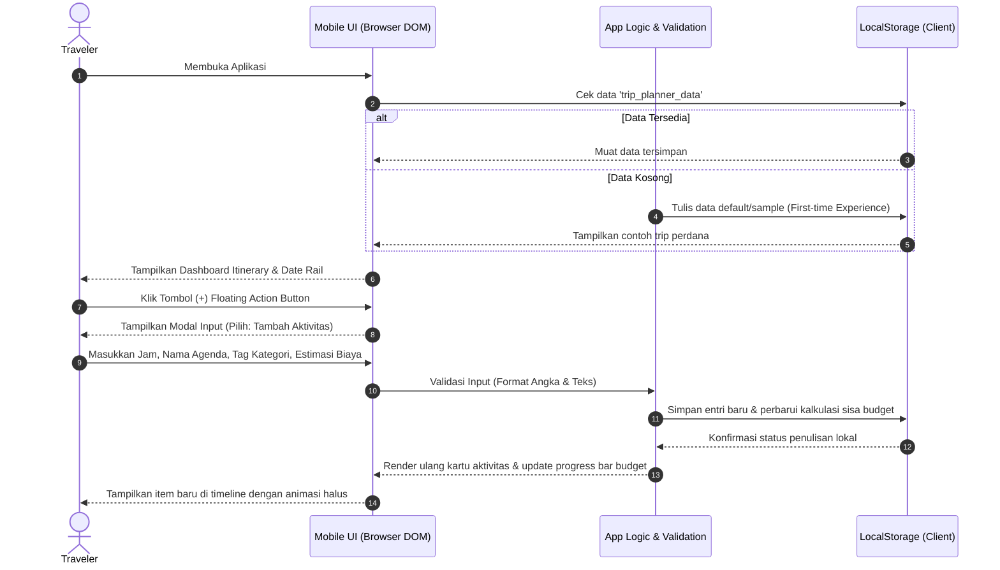
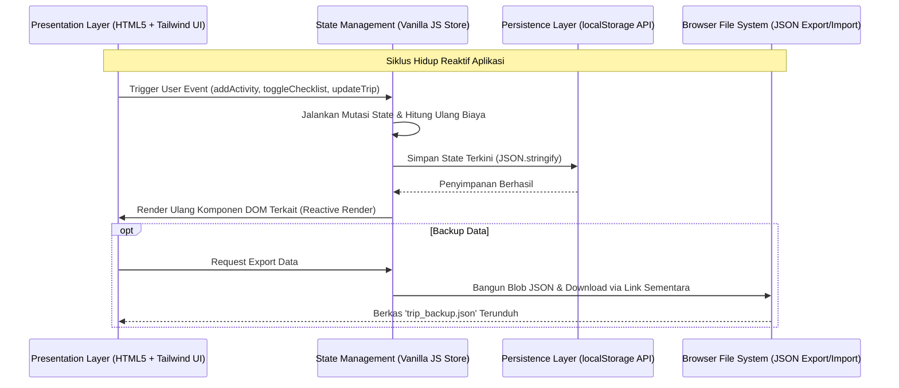
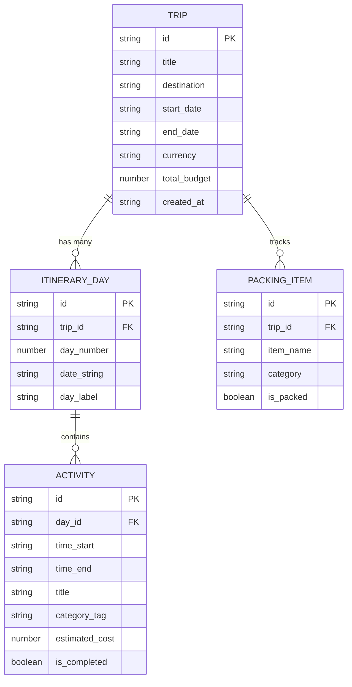

# PRD — Simple Trip Planner

## 1. Overview
**Simple Trip Planner** adalah aplikasi web produktivitas perjalanan personal berbasis *mobile-first* yang dirancang untuk memudahkan traveler menyusun jadwal harian, mengontrol anggaran, dan memantau perlengkapan secara cepat tanpa friksi teknis (*zero login, zero setup*). Masalah utama yang diselesaikan adalah fragmentasi perencanaan liburan yang sering kali tersebar di aplikasi catatan berantakan, spreadsheet yang kaku, atau platform pemesanan tiket komersial yang terlalu padat iklan.

Tujuan utama produk ini adalah menyediakan satu kanvas digital ramping (*pocket-sized single-pane dashboard*) yang menyerupai aplikasi ponsel pintar modern. Pengguna dapat mengelola agenda dari hari ke hari (*day-by-day itinerary*), melihat kalkulasi sisa anggaran secara *real-time*, dan menandai kelengkapan barang bawaan (*packing checklist*).

Aplikasi ini dirancang khusus untuk metode *vibe coding* menggunakan **IBM Bob** dengan pendekatan arsitektur *Single-File Application* (HTML, Tailwind CSS CDN, dan Pure JavaScript) yang langsung dapat dijalankan di peramban web peranti apa pun tanpa membutuhkan kompilasi backend, dependensi npm, maupun konfigurasi server yang rumit.

## 2. Requirements
Berikut adalah batasan dan persyaratan fungsional tingkat tinggi untuk sistem:

- **Aksesibilitas & Form Factor:** Aplikasi dirancang dengan prinsip *mobile-first*. Pada layar desktop, antarmuka ditampilkan dalam bingkai emulator *smartphone frame* yang elegan di tengah layar (*centered container*), sedangkan pada layar perangkat ponsel akan otomatis memenuhi layar (*full viewport width*).
- **Model Akses (Frictionless Single User):** Tidak ada alur login, registrasi akun, kata sandi, ataupun sesi server. Pengguna langsung dapat menggunakan aplikasi seketika halaman dimuat.
- **Penyimpanan Data (Local-First Persistence):** Seluruh data perjalanan, item jadwal, dan status checklist disimpan secara persisten di `localStorage` peramban pengguna. Jika halaman ditutup atau dimuat ulang, seluruh data tetap tersimpan utuh.
- **Portabilitas Data:** Sistem menyediakan fitur ekspor seluruh data ke dalam berkas `trip_backup.json` dan fitur impor berkas `.json` untuk memulihkan atau mentransfer data antargadget.
- **Kalkulasi Anggaran Real-time:** Sistem otomatis menjumlahkan estimasi biaya aktivitas dan memotongnya dari batas anggaran (*total budget cap*), lengkap dengan indikator visual jika pengeluaran melebihi batas.
- **Batasan Anti-Overengineering:** Sistem tidak menggunakan SDK peta pihak ketiga berbayar (seperti Google Maps API), tidak menggunakan library charting berat, serta tidak memerlukan database SQL/NoSQL eksternal.

## 3. Core Features
Fitur-fitur kunci yang menjadi cakupan rilis utama (MVP):

### 1. Mobile Shell & Dynamic Header
- **Greeting & Destination Banner:** Header bergaya modern ("HELLO, TRAVELER! Check your plans for: [Trip Name]"), indikator destinasi aktif, dan ikon pencarian/filter cepat.
- **Mode Switching:** Navigasi bilah bawah (*bottom bar*) untuk berpindah antara tampilan **Itinerary Timeline** dan **Packing Checklist**.

### 2. Vertical Date Rail & Timeline Itinerary
- **Vertical Date Rail:** Bilah tanggal di sisi kiri yang menampilkan blok tanggal (misal: "6 Oct", "10 Oct", "17 Oct") yang memisahkan agenda perjalanan per hari.
- **Activity Cards:** Kartu agenda di sisi kanan tanggal yang memuat:
  - Label waktu (*time pill badge*, misal: "12:00 - 1:00 PM").
  - Judul aktivitas & lokasi (misal: "Design Meeting / Explore Shibuya Crossing").
  - Kategori *tag pills* dengan warna kontras (misal: `FLIGHT`, `HOTEL`, `FOOD`, `EXPLORE`, `LEISURE`).
  - Estimasi biaya aktivitas.
  - Tombol aksi cepat: tanda selesai (*completed toggle*) dan tombol hapus.

### 3. Smart Budget & Expense Monitor
- **Budget Metric Widget:** Menampilkan ringkasan ringkas di bagian atas:
  - Total Alokasi Anggaran (*Total Budget*).
  - Total Estimasi Pengeluaran (*Spent/Planned*).
  - Sisa Anggaran (*Remaining Balance*).
- **Dynamic Visual Bar:** Bar kemajuan linier yang berganti warna dari hijau/violet ke merah jika pengeluaran melampaui 100%.

### 4. Packing & Preparation Checklist
- **Categorized Packing List:** Daftar barang bawaan yang dikelompokkan ke dalam kategori (Dokumen, Pakaian, Elektronik, Obat-obatan).
- **Interactive Checkbox:** Menandai barang yang sudah dikemas dengan pembaruan instan pada indikator kemajuan (misal: "8 dari 12 barang siap").
- **Quick Add Item:** Formulir ringkas untuk menambahkan item perlengkapan baru.

### 5. Floating Bottom Navigation & Quick Modal
- **Floating Bottom Bar:** Bilah navigasi melayang (*pill-shaped bottom bar*) dengan ikon **Home/Timeline**, tombol utama lingkaran menonjol `(+)` di tengah, dan ikon **Checklist**.
- **Unified Action Modal:** Menekan tombol `(+)` membuka lembar aksi (*bottom sheet/modal*) untuk:
  - Menambah agenda aktivitas baru (Hari, Waktu, Judul, Kategori, Biaya).
  - Mengubah profil trip (Nama Destinasi, Tanggal Mulai/Selesai, Total Budget).
  - Ekspor/Impor berkas JSON cadangan.

## 4. User Flow
Alur interaksi pengguna dari tahap inisialisasi hingga eksekusi harian:



### Langkah-langkah Penggunaan Mandiri:
1. **Inisialisasi Rencana:** Saat pertama kali dibuka, aplikasi memuat data demo (contoh perjalanan 3 hari) agar pengguna langsung memahami tata letak kartu dan navigasi.
2. **Penyusunan Agenda:** Pengguna menekan tombol `(+)` untuk memasukkan rencana kegiatan baru dengan menetapkan hari, jam, nama tempat, dan estimasi biaya.
3. **Pengecekan Anggaran:** Pengguna mengamati widget sisa anggaran untuk memastikan estimasi aktivitas harian tidak melebihi alokasi biaya trip.
4. **Pengepakan Koper:** Menjelang keberangkatan, pengguna beralih ke tab Checklist melalui bottom bar untuk mencentang barang yang sudah masuk ke koper.
5. **Cadangkan Data:** Pengguna membuka menu setelan via modal untuk mengunduh salinan berkas `.json` sebelum bepergian.

## 5. Architecture
Sistem mengadopsi arsitektur *Single-File Reactive State Pattern* murni di sisi peramban (*client-side only*):



### Penjelasan Komponen Teknis:
- **Presentation Layer (DOM):** Dibangun dengan elemen semantik HTML5 yang ditata menggunakan utilitas Tailwind CSS. Menggunakan tata letak kontainer ponsel dengan gaya *dark glassmorphism/card elevation*.
- **State Controller (Single Store):** Objek JavaScript global (`AppState`) yang menyimpan seluruh entitas aktif. Setiap perubahan data memicu fungsi render terarah (*targeted DOM update*) tanpa memerlukan re-render seluruh halaman.
- **Persistence Adapter:** Lapisan abstraksi sederhana yang bertugas mem-parsing (`JSON.parse`) dan menulis (`JSON.stringify`) data ke `localStorage` dengan penanganan galat (*try-catch block*) untuk menangani skenario memori penuh (*quota exceeded*).

## 6. Database Schema
Meskipun berjalan sepenuhnya di penyimpanan lokal (`localStorage`), struktur skema data distandarkan secara relasional agar konsisten dan mudah diintegrasikan ke backend jika diperlukan di masa depan.



| Entitas / Model | Tipe Data Kunci | Deskripsi Fungsional |
| :--- | :--- | :--- |
| **TRIP** | `id (UUID)`, `title`, `destination`, `total_budget (Float)` | Menyimpan metadata perjalanan, destinasi utama, dan batas total pagu biaya. |
| **ITINERARY_DAY** | `id (UUID)`, `trip_id (FK)`, `day_number (Int)`, `date_string` | Mengelompokkan agenda berdasarkan tanggal (misal: "Day 1 - 6 Oct"). |
| **ACTIVITY** | `id (UUID)`, `day_id (FK)`, `time_start`, `title`, `category_tag`, `estimated_cost (Float)`, `is_completed (Boolean)` | Butir agenda kegiatan harian, kategori *pill*, dan biaya aktivitas. |
| **PACKING_ITEM** | `id (UUID)`, `trip_id (FK)`, `item_name`, `category`, `is_packed (Boolean)` | Butir daftar bawaan barang dan status centang kesiapannya. |

## 7. Design & Technical Constraints

### 1. High-Level Technology & Stack Rules
- **Format Berkas:** Wajib berupa **satu berkas tunggal (`index.html`)** yang memuat seluruh HTML, styling, dan skrip JavaScript secara mandiri tanpa dependensi build tools (Vite/Webpack) atau server lokal.
- **Styling Library:** Menggunakan **Tailwind CSS via CDN** (`<script src="https://cdn.tailwindcss.com"></script>`) untuk styling instan berbasis utilitas.
- **Iconography:** Menggunakan SVG inline bersih (Lucide style) untuk menjaga efisiensi muat tanpa dependensi font icon eksternal yang berat.

### 2. Design System & Visual Aesthetics (Sesuai Referensi Video)
- **Tema Warna (Dark Tech Aesthetic):**
  - Background Utama: `#0D0D12` (Deep Charcoal / Pitch Black).
  - Card Surfaces: `#181820` / `#1E1E28` dengan batas halus (`border border-white/5`).
  - Warna Aksen Utama: `#6C5DD3` / `#7C3AED` (Electric Indigo/Purple) untuk tombol utama, sorotan tanggal aktif, dan status penting.
  - Tag Pills: `#262638` dengan teks kontras tinggi untuk kategori seperti `FLIGHT`, `FOOD`, `HOTEL`, `EXPLORE`.
- **Tata Letak & Kontur:**
  - Sudut melengkung halus (*radius* `rounded-2xl` dan `rounded-3xl`).
  - Layout *centered smartphone frame* dengan rasio aspek ponsel (maksimal lebar `max-w-md` atau `420px`), berbayang tebal (*shadow-2xl*) agar tampak seperti gawai fisik di layar desktop.
  - *Vertical Date Rail* di sebelah kiri dengan garis konektor tipis yang menyambungkan tanggal agenda harian.
  - *Bottom Navigation Bar* melayang (*floating dock*) dengan tombol tengah lingkaran menonjol (*elevated action button*).

### 3. Typography Rules
Sistem antarmuka wajib menerapkan konfigurasi font berikut untuk memastikan keterbacaan kode dan tampilan:
- **Sans:** `Geist Mono, ui-monospace, monospace`
- **Serif:** `serif`
- **Mono:** `JetBrains Mono, monospace`

### 4. Blueprint Prompt IBM Bob (3-Layer Architecture)
Saat melakukan proses *vibe coding* di IBM Bob, gunakan struktur prompt 3 lapis berikut agar hasil kode langsung akurat:

#### Layer 1: Role & Context
```text
Act as a Principal Front-End Engineer specialized in building ultra-clean, mobile-first web applications. Build a "Simple Trip Planner" web application that runs directly in the browser with zero build steps and zero server setup.
```

#### Layer 2: Task & Requirements
```text
Build a complete, self-contained single-file mobile web app (index.html) with:
1. Mobile smartphone frame layout centered on screen with dark theme (#0D0D12 background, #181820 card surfaces, and #6C5DD3 electric purple accents).
2. Dynamic Top Header displaying "HELLO, TRAVELER!", active trip destination, and budget metric summary card (Total Budget, Spent, Remaining, and dynamic progress bar).
3. Vertical Date Rail on the left (e.g., 6 Oct, 10 Oct, 17 Oct) displaying connected itinerary activity cards on the right.
4. Activity cards featuring time badge, title, category tag pills (FLIGHT, HOTEL, FOOD, EXPLORE), estimated cost, and check-off completion toggle.
5. Secondary Packing Checklist tab with categorized items and checked-item progress counter.
6. Floating bottom navigation bar with Itinerary tab, Checklist tab, and an elevated circular (+) action button.
7. Interactive modal to add new activities, edit trip budget, export data to JSON, and import backup JSON.
8. Full state persistence using browser localStorage with realistic pre-populated default trip data on first load.
```

#### Layer 3: Constraints & Output
```text
Constraints:
- Single index.html file containing all HTML, Tailwind CSS via CDN, and vanilla modern JavaScript (ES6+).
- Do not use external npm modules, React, or build tools.
- Typography: Use Geist Mono / ui-monospace for UI elements and JetBrains Mono for monetary/numerical values.
- Follow WCAG AA contrast standards, responsive on touch devices, and ensure zero console errors.
- Include clear code comments separating State, Storage, Rendering, and Event Handlers.
```